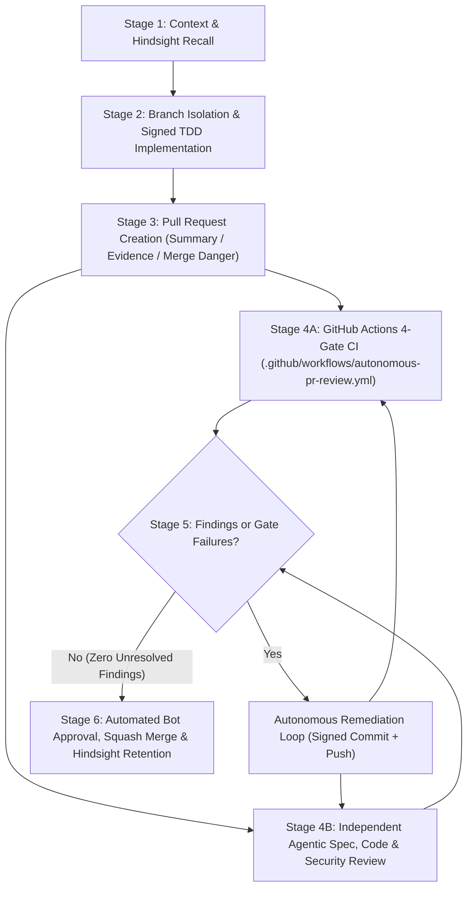

# Fully Autonomous Development Pipeline Specification (`wadamesh`)

This document defines the end-to-end **6-Stage Autonomous Development, Review, Remediation, and Merge Pipeline** governing all code, firmware configuration, board variant, and documentation changes in `TinkeringDao/wadamesh`.

---

## Architecture Overview



---

## Stage 1: Context & Hindsight Recall

Before modifying any source file, board variant (`variants/`), or build configuration (`platformio.ini`), the autonomous agent MUST:

1. **Query Hindsight Semantic Memory**:
   ```bash
   curl -s -X POST http://192.168.10.238:9100/v1/default/banks/satori/memories/recall \
     -H "Content-Type: application/json" \
     -d '{"query": "wadamesh MeshCore LVGL touch firmware SX1262 LR1110 AXP2101 BQ25896 legal RF safety"}'
   ```
2. **Read Repository Governance & Domain Specifications**:
   - [`AGENTS.md`](../../AGENTS.md) — Target board matrix, build commands, and RF/PMIC invariants.
   - [`LEGAL.md`](../../LEGAL.md) — 8-pillar legal compliance framework, EU RED / ETSI / FCC RF limits, and the German Statutory Addendum (`Addendum: German Statutory References`).
   - [`SECURITY.md`](../../SECURITY.md) — Coordinated vulnerability disclosure, cryptographic boundaries, and OPSEC rules.
   - [`docs/agents/domain.md`](domain.md) — Domain vocabulary and Architectural Decision Record (ADR) conventions.

---

## Stage 2: Branch Isolation & Signed TDD Implementation

1. **Branch Isolation**:
   - Direct pushes to `main` are blocked by the repository ruleset (`Protect main branch`).
   - All work MUST execute on a dedicated feature, bugfix, or chore branch (`feat/*`, `fix/*`, `chore/*`, `docs/*`) branched cleanly from `origin/main`.
2. **Cryptographically Signed Commits**:
   - Every commit MUST be authored by `TinkeringDao <203040288+TinkeringDao@users.noreply.github.com>` and signed with the organization's ED25519 SSH signing key (`git commit -S -s -m "..."`):
     ```bash
     git config user.name "TinkeringDao"
     git config user.email "203040288+TinkeringDao@users.noreply.github.com"
     git config commit.gpgsign true
     ```
3. **Hardware, RF & PMIC Safety Boundaries**:
   - **LoRa Transceiver Boundaries (`SX1262`, `LR1110`, `LR1121`, `LR2021`)**: Verify that regional frequency presets (`REGIONS.md`), external front-end amplifier (`PA` / `FEM`) gain offsets, conducted power (`dBm`), and duty-cycle ceilings (`<= 1%` in `868.0–868.6 MHz` SRD `g1`; `<= 10%` in `869.400–869.650 MHz` SRD `g3` under `ETSI EN 300 220-1/-2` / `Directive 2014/53/EU (RED)`; `FCC 47 C.F.R. Part 15.247`) are strictly respected.
   - **PMIC & Lithium-Ion Battery Boundaries (`AXP2101`, `BQ25896`, `BQ27220`)**: Verify that charge termination voltage (`<= 4.20–4.288 V`), fast-charge current (`C-rate`), and NTC temperature protection (`0–45 °C`) are never overridden beyond safe hardware datasheet ratings.
   - **Clean-Room & License Provenance**: Preserve `GPL-3.0-or-later` SPDX headers on `wadamesh` files and upstream `MIT` headers on MeshCore-derived components (`Directive 2009/24/EC`, `17 U.S.C. § 1201(f)`).

---

## Stage 3: Pull Request Creation

Open a Pull Request against `main` via GitHub CLI (`gh pr create`) containing three mandatory sections:

- `## Summary`: Concise technical explanation of what changed and why.
- `## Evidence`: Verification output from local builds, unit tests (`pio test`), or static analysis.
- `## Merge Danger`:
  - `Door: two-way | one-way` (whether the change is trivially reversible or alters persistent NVS/partition/OTA schemas).
  - `Blast Radius: local | module | system` (scope of affected boards, UI screens, or radio transports).

---

## Stage 4: Dual GitHub PR Review (Automated CI Gate + Agentic Spec/Code/Security Review)

Every Pull Request undergoes two complementary review tracks on GitHub:

### 4A. Automated 4-Gate GitHub Actions Workflow (`.github/workflows/autonomous-pr-review.yml`)

Triggered automatically on `pull_request` (`opened`, `synchronize`, `reopened`):

1. **Gate 1 — OPSEC & Zero-PII Scan**: Scans all changed files (`git diff --name-only origin/main...HEAD`) for leaked credentials, private keys, tokens (`ghp_`, `github_pat_`, `AKIA`), or local workstation user paths.
2. **Gate 2 — SSH Commit Signature & Author Verification**: Verifies that every commit in the PR range (`origin/main..HEAD`) carries a valid cryptographic SSH signature (`gpgsig`) and is authored by `203040288+TinkeringDao@users.noreply.github.com`.
3. **Gate 3 — 8-Pillar Legal, German Statutory Addendum & Governance Integrity**: Verifies the presence and non-empty integrity of `LEGAL.md` (including `## Addendum: German Statutory References (Applicable to Residents of Germany)`), `LICENSE`, `SECURITY.md`, `CODE_OF_CONDUCT.md`, `.github/CODEOWNERS`, `AGENTS.md`, `CLAUDE.md`, and `docs/agents/autonomous-pipeline.md`.
4. **Gate 4 — Project Configuration & Build Manifest Verification**: Verifies `platformio.ini` presence and structural integrity.

### 4B. Independent Agentic Spec, Code & Security Review

An independent Reviewer Subagent (`superpowers:subagent-driven-development` + `code-review` + `security-review`) inspects `gh pr diff <PR_NUMBER>` against:
- Specification completeness and architectural consistency (`AGENTS.md`, `docs/agents/domain.md`),
- Hardware/RF/PMIC safety boundaries (`SX1262` / `LR1110` ERP & duty cycle, `AXP2101` / `BQ25896` charge limits),
- Legal & OPSEC compliance (`LEGAL.md`, `SECURITY.md`),
and posts a structured review on the Pull Request (`gh pr review <PR_NUMBER> --comment --body "..."`).

---

## Stage 5: Autonomous Remediation Loop

If either the Reviewer Subagent (Stage 4B) or the automated CI workflow (Stage 4A) identifies any gap, regression, or improvement item:

1. The implementation agent addresses every finding on the PR branch.
2. Changes are committed with an ED25519 SSH signature (`fix(...): address PR review ...`) and pushed to `origin`.
3. Note that pushing a new commit automatically dismisses prior approvals (`dismiss_stale_reviews_on_push: true`) and re-triggers `.github/workflows/autonomous-pr-review.yml` on the new `HEAD` SHA.
4. A structured remediation summary comment (`gh pr comment <PR_NUMBER> --body "## Autonomous Remediation Complete ..."`) is posted on the PR referencing the remediation commit SHA.

---

## Stage 6: Automated Approval, Squash Merge & Hindsight Retention

1. **Automated Bot Approval**:
   - Once all 4 CI gates succeed on the latest commit and `HEAD_REPO == BASE_REPO && PR_AUTHOR == 'TinkeringDao'`, `.github/workflows/autonomous-pr-review.yml` executes `gh pr review "${PR_NUMBER}" --approve` as `github-actions[bot]`.
   - This satisfies the `Protect main branch` repository ruleset (`required_approving_review_count: 1`, `require_last_push_approval: true`, `required_signatures: true`).
2. **Squash Merge & Branch Cleanup**:
   - The approved PR is merged into `main` via:
     ```bash
     gh pr merge <PR_NUMBER> --squash --delete-branch
     ```
3. **Hindsight Knowledge Retention**:
   - Post-merge architectural decisions, resolved review findings, and commit SHAs are persisted to Hindsight:
     ```bash
     curl -s -X POST http://192.168.10.238:9100/v1/default/banks/satori/memories \
       -H "Content-Type: application/json" \
       -d '{"items": [{"content": "Merged PR #<N> in TinkeringDao/wadamesh: <summary>"}]}'
     ```
